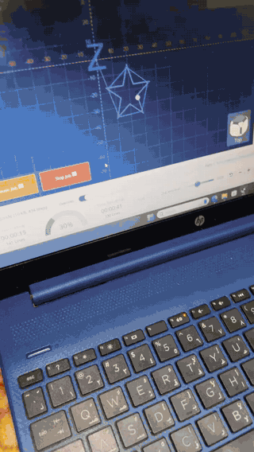
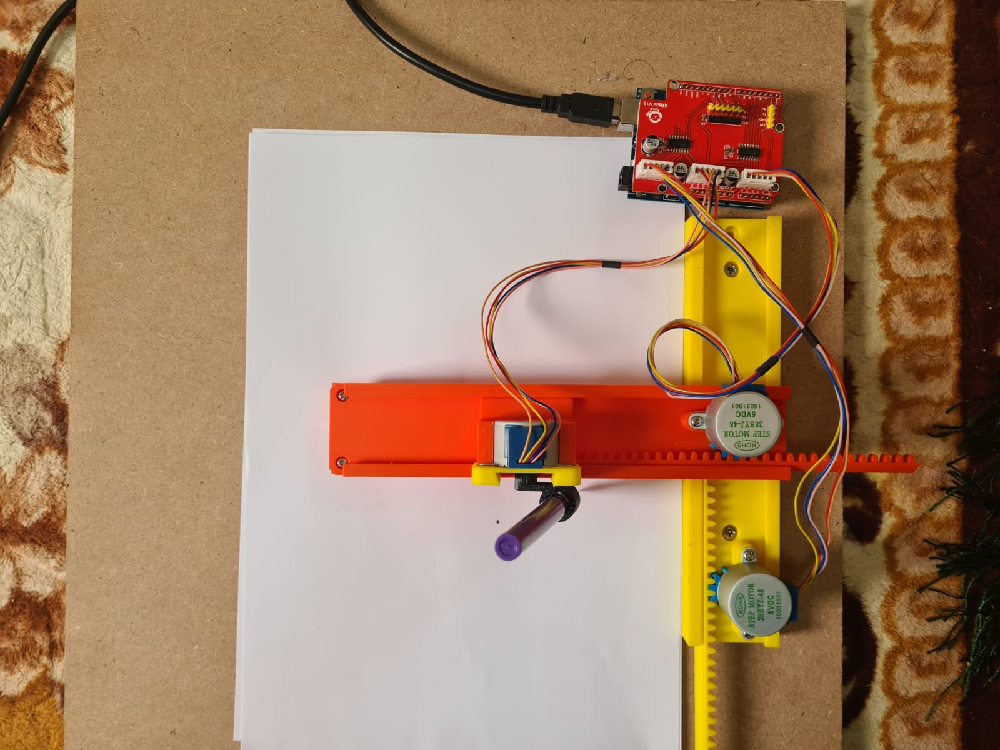
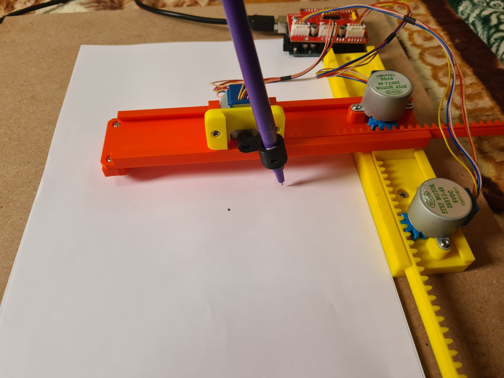
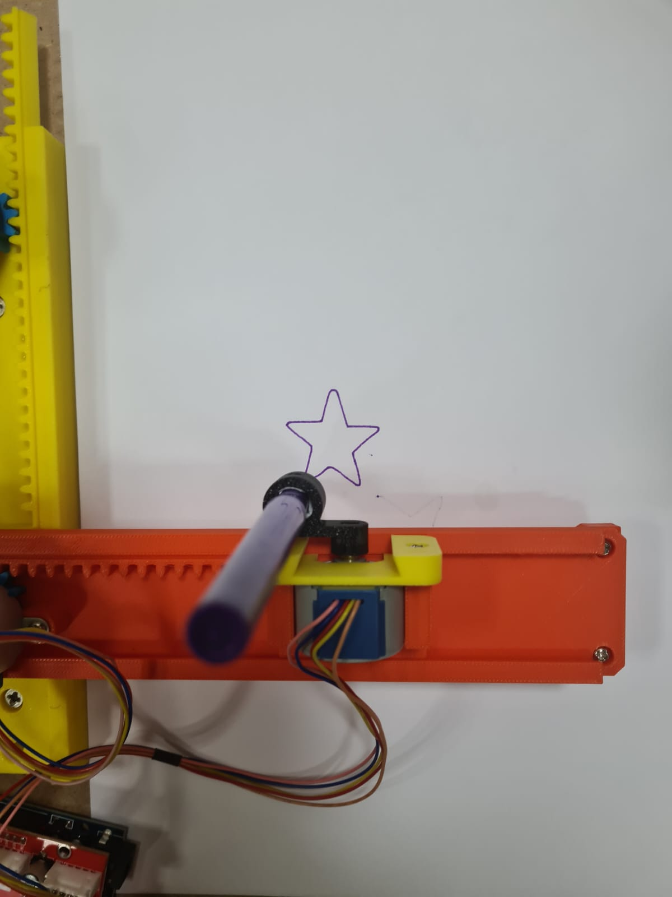
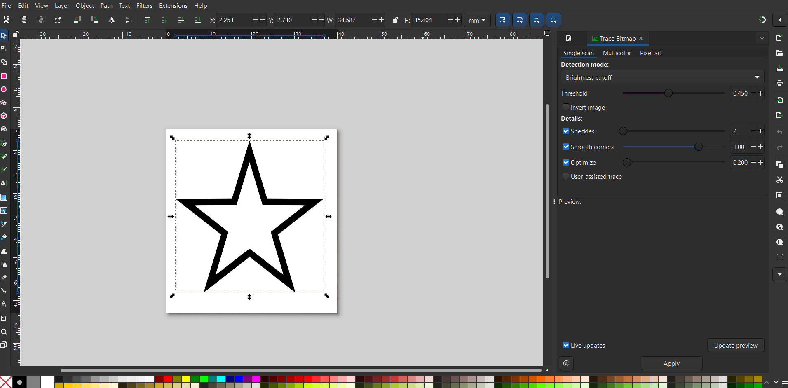
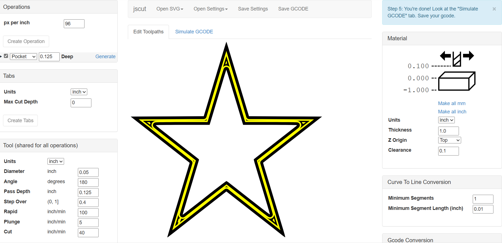
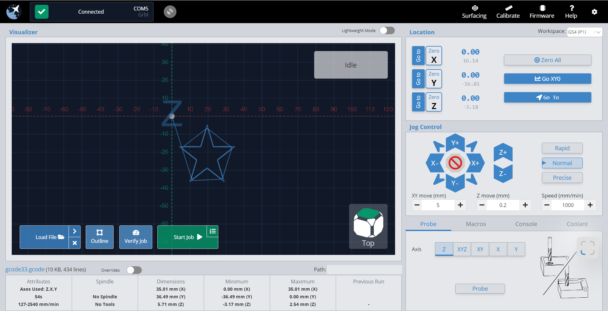
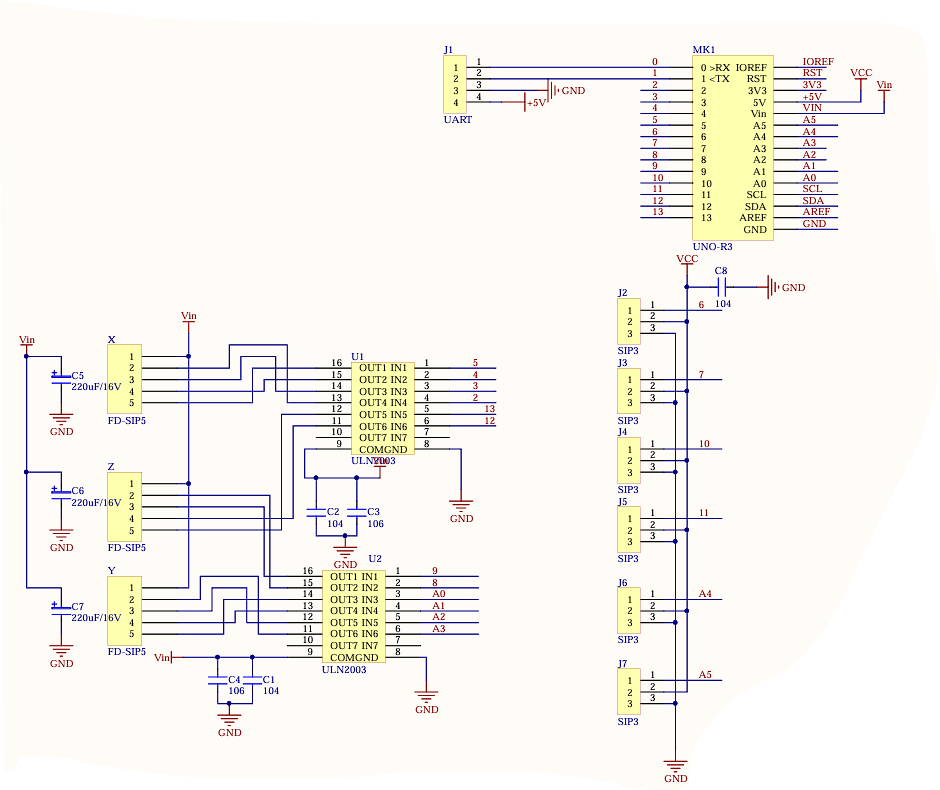

# Mini CNC Pen Plotter (Arduino + GRBL)

> Microprocessors (EE 3562) design project · team project

A small, low-cost **2-axis CNC pen plotter**. It is built from 3D-printed rack-and-pinion axes, 28BYJ-48 stepper motors and an Arduino Uno running **GRBL** firmware. Any drawing goes from Inkscape to G-code to paper.

## Demo

Full video: [`media/demo.mp4`](media/demo.mp4)

| Overview | Plotting | Result |
|---|---|---|
|  |  |  |

## Workflow: from image to drawing
| 1. Trace in Inkscape | 2. Generate G-code in jscut | 3. Stream with gSender |
|---|---|---|
|  |  |  |

1. Vectorise the design (Inkscape *Trace Bitmap*).
2. Create a pocket or outline toolpath and export G-code (jscut).
3. Send the G-code over USB to GRBL on the Arduino, which turns it into step pulses (gSender).

## Hardware
| Component | Qty | Notes |
|---|---|---|
| Arduino Uno R3 | 1 | Runs GRBL and interprets G-code |
| 28BYJ-48 stepper motors | 3 | X, Y and pen axis |
| ULN2003 drivers (on a KRbot V10 CNC shield) | - | Stepper drivers |
| 220 µF + 104 capacitors | 6 | Supply decoupling |
| 3D-printed PLA racks, pinions and mounts | - | Rack-and-pinion motion on an MDF base |
| 5 V / 12 V supply | 1 | Low-voltage operation |

GRBL's `main()` (setting up the serial port, steppers and system state) is shown in [`media/grbl_main.png`](media/grbl_main.png).

## Results (from the project report)
- Positional accuracy within **±0.1 mm** over a **20 × 20 cm** workspace
- Repeatable results when the same pattern is plotted several times
- Axis alignment calibrated iteratively by tuning steps/mm, speed and acceleration in GRBL

## Future work
A real Z-axis for light engraving, interchangeable tool heads (laser, knife) and closed-loop position feedback.
